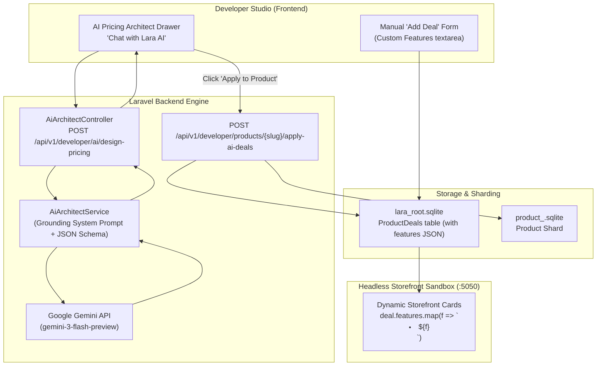

# Plan: Grounded AI Pricing Architect & Dynamic Deal Perks Engine

- **Slug:** `23-grounded-ai-pricing-architect-engine`
- **Status:** Pending
- **Created:** 2026-10-21
- **Target Products:** LaraLicensing Developer Studio, Laravel Backend, Storefront Sandbox

---

## 1. Executive Summary & Problem Context

Currently, the LaraLicensing Developer Portal allows creating products and deals, but:
1. Pricing deals store generic hardware seat and domain numbers, lacking custom, product-specific feature bullet points (`features: string[]`).
2. Developers building different software categories (e.g., Chrome Extension vs Desktop App vs WordPress Plugin) see generic "Hardware Seats" on their customer storefront.
3. Developers lack an intelligent assistant to formulate high-conversion pricing strategies without getting bogged down in complex licensing technicalities.

This plan designs and integrates the **Grounded AI Pricing Architect**: an interactive Copilot powered by Google Gemini (using the verified Gemini API key) that is strictly trained on LaraLicensing's architectural invariants, VPN-style Decoy pricing rules, and category-aware feature generation, coupled with a dynamic Storefront rendering engine.

---

## 2. Architecture & Invariants

### Invariants:
1. **Zero Raw Hallucinations:** The Gemini API must be constrained with system instructions, few-shot examples, and strict JSON schema (`responseMimeType: 'application/json'`).
2. **Schema Uniformity:** Every deal must strictly emit `dealName`, `dealCode`, `billingInterval`, `priceCents`, `allowedMachineSeats`, `allowedDomains`, `isDecoyTarget`, and `features: string[]`.
3. **Decoy Pricing Strategy Compliance:** The AI must always anchor with a monthly plan, discount the annual plan, and construct an irresistible 2-year decoy target (`isDecoyTarget: true`) with 70–82% savings.
4. **Category Agnosticism:** The backend does not use brittle hardcoded `if/else` category trees; the AI generates natural, domain-specific perks (e.g. "Leads/mo" for extensions, "Machine Seats" for desktop, "Domains" for plugins), and the storefront renders whatever features are present.
5. **Lovable & Repository Integrity:** No git history rewriting; PascalCase tables, camelCase columns, positive booleans (`isActive`, `isDecoyTarget`).

---

## 3. Step-by-Step Implementation Breakdown

### Phase 1: Database & Model Schema Extension
- [ ] Add `features` TEXT (JSON-encoded) column to `ProductDeals` table in `backend/database/lara_root.sqlite`.
- [ ] Update `ProductDeal.php` model with `'features' => 'array'` in `$casts` and fillable array.
- [ ] Update `ProductService.php` to accept and serialize `features` when creating products or adding deals.

### Phase 2: Grounded AI Architecture Engine (Backend)
- [ ] Save the verified Gemini API key into `backend/.env` as `GEMINI_API_KEY`.
- [ ] Implement `backend/app/Services/AiArchitectService.php`:
  - Grounding prompt containing the 3-actor model, VPN decoy rules, and category intelligence.
  - Strict JSON schema for guaranteed database compatibility.
  - Resilient call to `gemini-3-flash-preview` with timeout and fallback handling.
- [ ] Implement `backend/app/Http/Controllers/Developer/AiArchitectController.php`:
  - `POST /api/v1/developer/ai/design-pricing`: Takes product metadata + user prompt, returns pricing advice and structured deals.
  - `POST /api/v1/developer/products/{slug}/apply-ai-deals`: Atomically wipes draft/seeded deals and saves the AI-generated deal matrix to the product.
- [ ] Register routes in `backend/routes/api.php`.

### Phase 3: Interactive Developer Portal UI (Frontend)
- [ ] Add an **"AI Pricing Architect"** chat drawer / dialog in `src/components/developer/DeveloperProductsDashboard.tsx`.
- [ ] Provide interactive prompt starters (e.g. *"Design high-converting SaaS tiers for this product"*).
- [ ] Render the AI's explanation and a preview of the proposed deal cards.
- [ ] Add an **"Apply Deals to Product"** button that saves the deals directly to the backend without manual typing.
- [ ] Update the manual **"Add Deal"** modal to include a multi-line **"Feature Perks (one per line)"** textarea for developers who prefer manual input.

### Phase 4: Dynamic Headless Storefront Sync
- [ ] Update `testing-sandbox/developer-storefront-sandbox/app_developer_storefront.py`:
  - Modify the card rendering template: if `deal.features` exists and has items, render `deal.features.map(...)`.
  - Graceful fallback: if `deal.features` is empty, display the standard seats and domains licensing specs.
- [ ] Ensure anti-caching headers remain active so storefront updates instantly upon deal sync.

### Phase 5: End-to-End Empirical Verification
- [ ] Open Developer Studio and test the AI Architect on `leadhunter` (ChromeExtension).
- [ ] Confirm Gemini generates custom extension perks (e.g. *1,000 Leads/mo, CSV Export, Chrome Profile*).
- [ ] Click **"Apply Deals"** and confirm database persistence in `lara_root.sqlite`.
- [ ] Open `http://localhost:5050/?slug=leadhunter` and verify the storefront renders the custom extension perks with the decoy ribbon!
- [ ] Re-sync `lara-sandbox-desktop-client` on the storefront to guarantee desktop products remain unaffected and fully functional.
