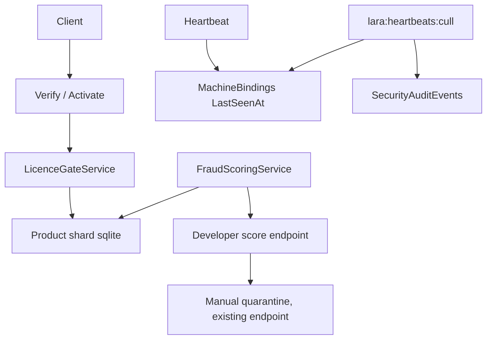

# Fraud Phase 2: LicenceGate, heartbeat culling, fraud scoring

Branch: muse only. Main untouched. No force-push.

## Scope

1. LicenceGateService: one read-only licence status check.
   Product active, licence found, not revoked, not expired, active
   seat count, allowed seats. No auto-register, no seat binding,
   no JIT promote. Other services use this gate instead of
   repeating the same checks in different places.
2. HeartbeatCullService plus Artisan command lara:heartbeats:cull.
   Per product shard, release MachineBindings whose LastSeenAt
   is older than the stale threshold. Default 45 minutes, which
   is a 30 minute heartbeat window plus a 15 minute resurrection
   window for sleep and wake. Dry-run mode first, audit row per
   culled binding in SecurityAuditEvents.
3. FraudScoringService plus a developer-only score endpoint.
   Score in 0 to 100, with reasons, not a single-signal block.
   Tamper events in 7 days add 30 each, capped. Server-observed
   concurrent active bindings above allowed seats add 40.
   Score 70 or more is a quarantine recommendation for developer
   review, not an automatic revoke on its own.

## Safety rules

- A client tamper report alone never auto-revokes. Tamper is a
  client report and can be spoofed. Auto-quarantine, when it is
  added later, must use server-observed facts only, such as
  concurrent bindings counted by the server.
- Cull never deletes a licence. It releases a stale seat only,
  so the licence can be re-activated on a live machine.
- Scoring is log and review first. Verify and activate keep
  their existing hard checks: revoked, expired, seat limit,
  and the existing risk assessment. Scoring does not add a
  new block to verify in this phase.

## Diagram

## Tests

- LicenceGate: valid, revoked, expired, not found, product not found.
- Cull: stale binding released, live binding kept, dry-run releases nothing.
- Scoring: tamper count, concurrent bindings above seats, score 70 recommendation.
- EndpointInventory and FunctionBodyLineCap must stay clean for new code.

## Not in this phase

- MinVersion server enforcement, code signing, extension thin
  client, prompt-injection as security, scheduled cron for cull.
  The cull command is manual in this phase; scheduling is a
  separate user decision.
