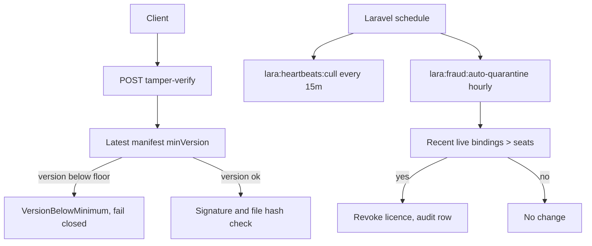

# Fraud Phase 3: minVersion enforcement, auto-quarantine, scheduling, signing guidance

Branch: muse only. Main untouched. No force-push.

## Scope

1. MinVersion server enforcement in tamper-verify.
   The latest signed manifest for a product defines the floor.
   If a client submits an older signed manifest whose
   releaseVersion is below that latest minVersion, tamper-verify
   fails with VersionBelowMinimum, even though the old signature
   itself is valid. This blocks rollback to an old, less-checked
   build. Version comparison strips a leading v and uses
   PHP version_compare.
2. Auto-quarantine on server-observed facts only.
   A new service and a new command, lara:fraud:auto-quarantine,
   scan product shards. A licence is quarantined, which means
   revoked and inactive, only when the server counts more
   recent live bindings than allowed seats. Recent means
   LastSeenAt within 45 minutes, so stale seats do not trigger
   a false quarantine. Tamper events alone never auto-quarantine,
   because a client report can be spoofed.
3. Scheduling.
   Heartbeat cull every 15 minutes and auto-quarantine hourly,
   registered in bootstrap/app.php with withoutOverlapping.
   This registers the schedule in code. It does not by itself
   run on a host: the host must still run artisan schedule:run
   every minute, which is a deployment step, not a code change.
4. Code signing and thin client guidance.
   A shipped developer doc, docs/licensing/code-signing-and-thin-client.md,
   covering Authenticode plus timestamping, macOS notarization,
   what not to ship, and thin extension client rules. No
   deceptive prompt strings are shipped as a security feature.

## Diagram

## Tests

- MinVersion: old signed manifest fails after a newer manifest
  sets a higher floor, new manifest still passes.
- Auto-quarantine: recent concurrent bindings above seats
  quarantine, stale bindings do not, tamper events alone do not.
- Dry-run auto-quarantine changes nothing.
- EndpointInventory and FunctionBodyLineCap stay clean for new code.

## Not in this phase

- Prompt-injection as security, rejected.
- Host cron setup for schedule:run, deployment only.
- Extension store submission, which is a developer action.
