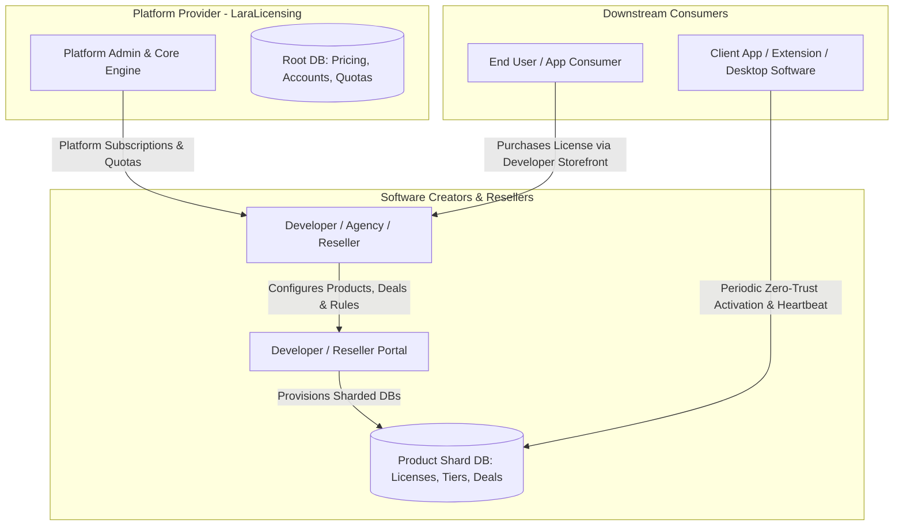

# Platform Ecosystem, Capability-Based Licensing & Reseller Architecture Specification

Status: Draft  
Author: Principal Architect & AI Assistant  
Version: 1.0.0  
Date: 2026-10-19  
Target System: LaraLicensing Platform  

---

## 1. Executive Summary

This specification defines the three-actor SaaS licensing ecosystem based on the system design session. The platform functions as an enterprise licensing engine where software creators (developers, agencies, SaaS vendors) acquire licensing infrastructure from us to license, throttle, protect, and distribute their digital products (extensions, plugins, desktop applications, web services) to their own downstream customers.

---

## 2. Three-Actor Domain Model



### 2.1 Actor Taxonomy

1. **Platform Owner (Tier 1 - Us):**
   - Owns and operates the LaraLicensing SaaS infrastructure.
   - Sells platform subscription tiers and quota allocations to developers and resellers.
   - Maintains Root DB (`backend/database.sqlite`) containing accounts, global quotas, subscription statuses, and audit registries.

2. **Software Creator / Reseller (Tier 2 - Our Direct Customer):**
   - Software developers, Chrome extension creators, WordPress plugin authors, desktop app makers, and regional resellers.
   - Purchases a platform package (Free, Essential, Pro, Max, Lifetime Deal, or Biennial Target).
   - Operates a dedicated Developer Portal to create Products (e.g., "Elementor Assistant", "LeadScraper Pro").
   - Defines custom pricing packages, deal tiers, machine limits, and domain entitlements for their products.
   - Accesses auto-generated, AI-ready integration blueprints (Markdown contracts) to plug licensing verification into their client codebases.

3. **Downstream Consumer (Tier 3 - End User):**
   - The end user purchasing or using the developer's software product.
   - Interacts only with the developer's application and activation prompts.
   - Never interacts directly with LaraLicensing Root management surfaces.
   - Transmits periodic zero-trust verification pings and machine fingerprints.

---

## 3. Platform Tier & Decoy Pricing Strategy

Platform packages sold to developers incorporate anchor and decoy pricing psychology to maximize annual and biennial adoption.

### 3.1 Platform Subscription Matrix

| Tier Name | Monthly Anchor | Annual Rate | Biennial Decoy Target | Quota Entitlements | Allowed Products | Support SLA |
|---|---|---|---|---|---|---|
| **Starter / Free** | $0.00 (Year 1, then $1.00/mo) | N/A | N/A | 100 req/day (max 15/hr) | 1 Product | Community |
| **Essential** | $2.50/mo | $19.90/yr ($1.65/mo) | $35.00/2yr ($1.45/mo) | 200 req/day (max 25/hr) | 3 Products | Standard |
| **Pro** | $5.00/mo | $49.90/yr ($4.15/mo) | $89.00/2yr ($3.70/mo) | 1,000 req/day (max 120/hr) | 15 Products | Priority |
| **Max / Enterprise** | $9.90/mo | $89.00/yr ($7.41/mo) | $149.00/2yr ($6.20/mo) | 5,000 req/day (max 500/hr) | 50 Products | Dedicated |
| **Lifetime Deal (LTD)** | N/A | N/A | $999.00 one-off | 10,000 req/day (unlimited burst) | Unlimited Products | VIP Direct |

### 3.2 Pricing Principles
- **Decoy Framing:** Display the 2-Year or Annual plan alongside single-month pricing to highlight 70% to 82% savings.
- **Value Stepping:** Every step up in tier unlocks an exponential leap in quota and product capacity (e.g., 5x products for only 2x price increase).
- **Hard Quota Enforcement:** When a developer exceeds hourly or daily request caps, requests enter rate-limited queuing with HTTP 429 and `retryAfter` timestamps.

---

## 4. Capability-Based Access Control Architecture

Rather than assigning static role strings (`isAdmin`, `isManager`), permissions are modeled as dynamic, metered capabilities.

### 4.1 Core Capability Primitives

Each license or user account carries a capability matrix evaluated at runtime:

```json
{
  "capabilities": {
    "canCreateProduct": true,
    "maxProductCount": 15,
    "maxDomainsPerLicense": 3,
    "maxMachineSeats": 5,
    "allowedIntervals": ["monthly", "annual", "lifetime"],
    "dailyRequestQuota": 1000,
    "hourlyRequestQuota": 120,
    "canIssueOfflineTokens": true,
    "canManageResellers": false,
    "canExportAuditLogs": true
  }
}
```

### 4.2 License Policy Types
- **Single User / Node Locked:** Restricted to exactly 1 machine fingerprint (HWID) or 1 domain.
- **Multi-Seat / Team:** Pool of N allowed seats (e.g., 3, 5, 10) dynamically claimed by hardware fingerprints.
- **Floating Seat:** Ephemeral seat released after session inactivity or explicit heartbeat timeout.
- **Lifetime Deal (LTD) Token:** Fixed perpetual license with no expiry, optionally bound to machine limits.
- **Time-Bound Subscription:** Valid until `expiresAt`, requiring periodic online token renewal.

---

## 5. Split-Database Partitioning (SQLite M2 Architecture)

To maintain millisecond lookup latencies and avoid SQLite write lock contention, data is segregated across independent SQLite databases:

```
backend/
├── database.sqlite                         (Root Database: Accounts, Tiers, Reseller Quotas, Audit Index)
└── database/
    ├── shard_reseller_<slug>.sqlite        (Reseller Partition: Sub-clients, Wholesale allocations)
    ├── product_<productSlug>.sqlite        (Product Partition: Packages, Serials, Capabilities)
    └── users_<productSlug>.sqlite          (Consumer Partition: End-user profiles, HWID bindings)
```

### 5.1 Partitioning Invariants
- **N-Squared Scaling Control:** Shards target bounded row counts (100 to 200 records per operational table segment) to eliminate query degradation.
- **WAL Mode & Busy Timeout:** Every SQLite connection executes `PRAGMA journal_mode=WAL;` and `PRAGMA busy_timeout=5000;` on startup.
- **Connection Isolation:** Shard models explicitly specify `$connection = 'shard'` to prevent queries from accidentally touching the Root DB.

---

## 6. Zero-Trust (ZT) Verification & Periodic Check Lifecycle

To preserve server bandwidth and minimize friction for end consumers, license verification utilizes an asymmetric Zero-Trust model:

1. **Activation (Online):**
   - Client sends `serialKey`, `machineFingerprint`, and client metadata.
   - Server validates serial, checks seat availability, registers binding, and issues an Ed25519-signed JWT offline token.
2. **Offline Operation:**
   - Client application verifies the cryptographic signature locally using the public key embedded during build.
   - Verification succeeds instantly without network calls during normal execution.
3. **Periodic Re-verification (Cadence):**
   - Monthly licenses re-verify every 7 days (not every minute or hour).
   - Annual licenses re-verify every 14 days.
   - Lifetime licenses re-verify every 30 days or on major version upgrade.
4. **Fraud & Geo-Velocity Mitigation:**
   - Detect concurrent heartbeats from distinct geographic regions within impossible travel windows.
   - Detect HWID mismatches or seat count overflows.
   - Trigger automatic quarantine and notify the developer via flash and webhook notifications.

---

## 7. Decoupled Payment Architecture

LaraLicensing explicitly does not process or store credit card credentials.

### 7.1 Separation of Concerns
- **Zero Cardholder Data:** No PAN, CVV, or cardholder credentials ever transit or store within LaraLicensing servers.
- **Webhook-Driven Issuance:** The developer utilizes their own payment gateway (Stripe, LemonSqueezy, Paddle, bKash). Upon successful checkout, their server dispatches a signed webhook payload to:
  `POST /api/v1/products/{productSlug}/licenses/issue`
- **Idempotency Safeguards:** Every issuance request requires an `idempotencyKey` matching the gateway transaction ID to prevent duplicate serial generation.

---

## 8. AI-Ready Integration Blueprint Generator

The Developer Portal provides a one-click "Export Integration Prompt" feature. Developers copy an auto-generated Markdown blueprint and paste it into AI coding assistants (Gemini, Claude, Cursor, Copilot) to automatically inject license verification into their applications:

```markdown
### Integration Prompt Template
You are integrating LaraLicensing into this project:
- Product Slug: {{productSlug}}
- Verification Endpoint: {{verifyUrl}}
- Public Key (Ed25519): {{ed25519PublicKey}}
- Verification Interval: Every 7 days
- Implement HWID fingerprinting via machine GUID / MAC hash.
- Cache the offline activation token in secure local storage.
```

---

## 9. Reseller Subsystem & Delegation

Resellers operate as wholesale partners with dedicated sub-dashboards:
- **Quota Allocation:** Resellers purchase bulk serial pools (e.g., 500 licenses of "Essential" tier).
- **Custom Offer Creation:** Resellers set their own retail prices, package names, and localized payment terms.
- **Customer Lifecycle:** Resellers can activate, suspend, extend, or transfer licenses within their assigned quota pool.
- **Alert Dispatch:** Flash notifications and email alerts notify resellers when their quota drops below 15%.
