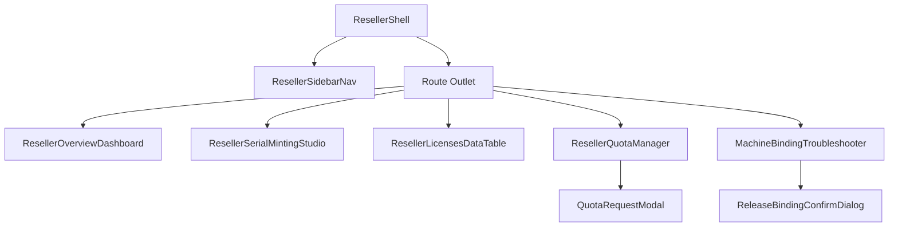

# 52. Reseller Portal Comprehensive Architecture Specification

**Version:** 1.0.0  
**Status:** Normative for LaraLicensingV1  
**Updated:** 2026-10-22  
**Domain:** Reseller Wholesale Distribution, Quota Economics, Machine Telemetry & Portal UI  

---

## 1. Executive Overview & Problem Context

The Reseller Portal provides an autonomous, multi-tenant B2B wholesale distribution environment within LaraLicensing. Channel partners (agencies, regional distributors, white-label vendors) can issue branded software licenses within strictly enforced quota allowances, inspect downstream machine activations, troubleshoot customer hardware locks, and request quota increases without administrative intervention.

### Core Architectural Pillars:
1. **Branded Serial Minting:** Deterministic, reversible serial formatting with verified vanity prefixes (`{Prefix}-{Category}-{Version}-{Random}`).
2. **Append-Only Quota Ledger:** High-concurrency, double-entry transactional accounting (`ResellerQuotas` and `ResellerQuotaLedger`) preventing over-issuance via row-level `FOR UPDATE` guards.
3. **Downstream Machine Telemetry & Troubleshooting:** Zero-knowledge SHA-256 hardware fingerprinting with seat quotas, 15-minute rebind cooldowns, and reseller diagnostic unbinding.
4. **Enhanced Full-Width UI:** Fluid Cryptlex-grade layout, real-time KPI metrics, serial generator studio, interactive quota request timeline, and machine binding inspector.
5. **Universal Error Logging:** Strict compliance with `02-spec/03-error-manage/`, Universal Response Envelopes, and zero swallowed exceptions.

---

## 2. Branded Serial Minting Specification

### 2.1 Format Definition
Serials generated by a Reseller must strictly adhere to the canonical format:
$$\text{Format: } \{\text{ResellerPrefix}\}-\{\text{CategoryCode}\}-\{\text{VersionCode}\}-\{\text{RandomGroups}\}$$

* **`ResellerPrefix`**: 3 to 12 uppercase alphanumeric characters (`^[A-Z0-9]{3,12}$`). Must be owned by the authenticated reseller and active in `Prefixes`.
* **`CategoryCode`**: Single character corresponding to `LicenseCategoryType`:
  * `D` = Daily Pass
  * `W` = Weekly Pass
  * `M` = Monthly Subscription
  * `Y` = Yearly Subscription
  * `L` = Lifetime Deal (LTD)
  * `X` = Developer / Internal
  * `K` = Node-Locked Standard Key
* **`VersionCode`**: Major version identifier (e.g. `V1`, `V2`).
* **`RandomGroups`**: Cryptographically secure alphanumeric string grouped in 4-character blocks separated by hyphens (e.g., `9F3K-2XQ8-77TA`).

### 2.2 Serial Invariants & Security
1. **Prefix Ownership Assertion:** The backend must execute `assertPrefixOwnership($resellerId, $prefixValue)`. Any attempt by Reseller $A$ to mint a serial using Reseller $B$'s prefix aborts with `403 AuthzPermissionDenied`.
2. **Decodable Reversibility:** Metadata (reseller, duration category, and product version) is structurally extractable by downstream offline clients without requiring database lookups.
3. **Collision Resilience:** Serials are indexed with a `UNIQUE` constraint on `Serials.SerialValue`. Generation incorporates a bounded backoff retry (up to 5 attempts). If all attempts collide, the server logs `WARN [SerialGenerationCollision]` and aborts with `500 InternalServerError`.

---

## 3. Append-Only Quota Ledger & Self-Service Approval

### 3.1 Data Model
* **`ResellerQuotas` (State Cache):**
  * `ResellerId` (UUID / INT)
  * `LicenseCategoryId` (INT)
  * `LicenseTierId` (INT)
  * `LicensesGranted` (INT)
  * `LicensesConsumed` (INT)
  * `LicensesRemaining` (Generated: `LicensesGranted - LicensesConsumed`)
  * `PeriodStart`, `PeriodEnd` (DATETIME UTC)
* **`ResellerQuotaLedger` (Append-Only Journal):**
  * `Id` (UUID PK)
  * `ResellerId` (UUID / INT)
  * `LicenseCategoryId`, `LicenseTierId` (INT)
  * `Delta` (INT: `-1` for issuance, `+1` for revocation within grace period, `+N` for admin approval)
  * `Action` (`Consumed`, `Restored`, `Adjusted`)
  * `ReferenceId` (UUID: related `LicenseId` or `QuotaRequestId`)
  * `OccurredAt` (DATETIME UTC)

### 3.2 Transactional Invariants
1. **Pessimistic Locking on Mint:** Every license creation initiates a database transaction:
   ```sql
   SELECT LicensesGranted, LicensesConsumed 
   FROM ResellerQuotas 
   WHERE ResellerId = ? AND LicenseCategoryId = ? AND LicenseTierId = ? 
   FOR UPDATE;
   ```
2. **Exhaustion Guard:** If `LicensesConsumed >= LicensesGranted`, the transaction rolls back immediately with `409 QuotaExhausted`.
3. **Atomic Consumption:** Increments `LicensesConsumed = LicensesConsumed + 1` and inserts a ledger record (`Delta = -1, Action = 'Consumed'`) in the identical transaction.
4. **Quota Restoration on Revoke:** If a reseller revokes an active license within 24 hours of issuance, the engine decrements `LicensesConsumed` and logs `Delta = +1, Action = 'Restored'`.

### 3.3 Self-Service Quota Approval State Machine
$$\text{Pending} \longrightarrow \text{Approved} \mid \text{Denied} \mid \text{Cancelled}$$
* **Submission:** Reseller specifies requested seat delta and justification (`POST /Api/Reseller/QuotaRequests`).
* **Approval:** Admin inspects justification and issues `ApprovedDelta`. Atomically increments `ResellerQuotas.LicensesGranted` and writes `Delta = ApprovedDelta, Action = 'Adjusted'`.
* **Denial:** Admin rejects request. Requires `DenialReason` ($\ge 10$ characters).
* **Anti-Self-Approval:** Admins linked to a reseller cannot approve their own requests.
* **Idempotency:** State changes require an `Idempotency-Key` header.

---

## 4. Downstream Machine Binding & Troubleshooting Specification

### 4.1 Canonical Hardware Fingerprinting
Client applications generate hardware fingerprints using 4 normalized system properties:
$$\text{CanonicalString} = \text{MacPrimary} \parallel \text{"|"} \parallel \text{MotherboardSerial} \parallel \text{"|"} \parallel \text{CpuIdHex} \parallel \text{"|"} \parallel \text{MachineGuid}$$
* `FingerprintHash = SHA-256(UTF-8(CanonicalString))` (64 lowercase hex characters).
* Raw hardware identifiers are never persisted; only `FingerprintHash` is stored in `MachineBindings`.

### 4.2 Machine Binding Lifecycle
* **Concurrent Seat Quotas:** Each license tier enforces `MaxConcurrentBindings` (e.g., 1 to 5 machines).
* **Binding Verification:** Active machines have `ReleasedAt IS NULL`. Re-verifying an existing machine binding is a zero-cost no-op that updates `LastSeenAt`.
* **Seat Overflow:** If a new machine attempts activation when `COUNT(active) >= MaxConcurrentBindings`, the server rejects with `409 MachineQuotaExceeded`.

### 4.3 Reseller Troubleshooting Controls
* **Inspect Bindings:** Resellers query `GET /Api/Reseller/Licenses/{LicenseKey}/Bindings` to view all active hardware hashes, IP addresses, client software versions, and last-seen timestamps.
* **Autonomous Release / Reset:** Resellers can release a defective or replaced client machine (`POST /Api/Reseller/Licenses/{LicenseKey}/Bindings/{BindingId}/Release`).
* **15-Minute Cooldown Guard:** Released fingerprints receive `RebindCooldownUntil = NOW() + 15 minutes` to prevent floating-seat exploitation.
* **Diagnostic Audit Lineage:** Releases emit a `MachineUnbound` audit log entry with `ReleaseReason = 'ResellerInitiated'`.

---

## 5. Enhanced Reseller Portal UI Architecture

### 5.1 Layout & Navigation Shell
* **Full-Width Fluid Workspace:** Adopts the Cryptlex-style layout eliminating container width locks (`max-w-none px-6 lg:px-10`).
* **Collapsible Sub-Navigation:**
  1. `Overview`: Real-time KPI cards, quota utilization gauge, recent activations.
  2. `Serial Minting Studio`: Visual prefix picker, live serial format preview, multi-seat issuance.
  3. `License Inventory`: Filterable, sortable DataTable with status badges, expiry dates, and quick actions.
  4. `Quota Economics`: Balance cards, ledger transaction history, interactive quota request modal.
  5. `Hardware Troubleshooting`: Serial search, active machine cards, one-click release dialog, and binding event logs.

### 5.2 Component Hierarchy


---

## 6. Error Management & Logging Integrity

In strict adherence to `02-spec/03-error-manage/`:
1. **Universal Response Envelope:**
   ```json
   {
     "Status": {
       "IsSuccess": true,
       "Code": 200,
       "Message": "OK"
     },
     "Attributes": {
       "RequestId": "req-reseller-9a8f21",
       "Timestamp": "2026-10-22T17:50:00Z"
     },
     "Results": []
   }
   ```
2. **Zero Swallowed Exceptions:** Every `catch` block must log the failure using `Log::error()` or `reportLovableError()` with structured context (`resellerId`, `operation`, `payload`) before returning a typed `LaraException`.
3. **Frontend Error Surfacing:** Mutations utilize the `useLaraErrorToast` hook to present actionable error feedback without modal crashing.
