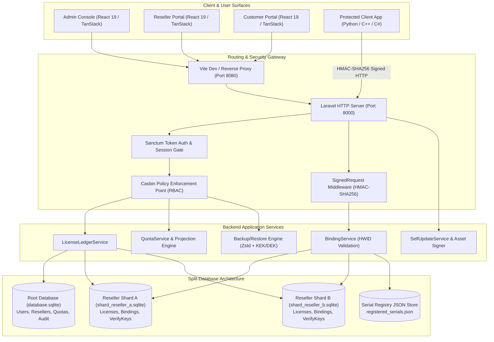
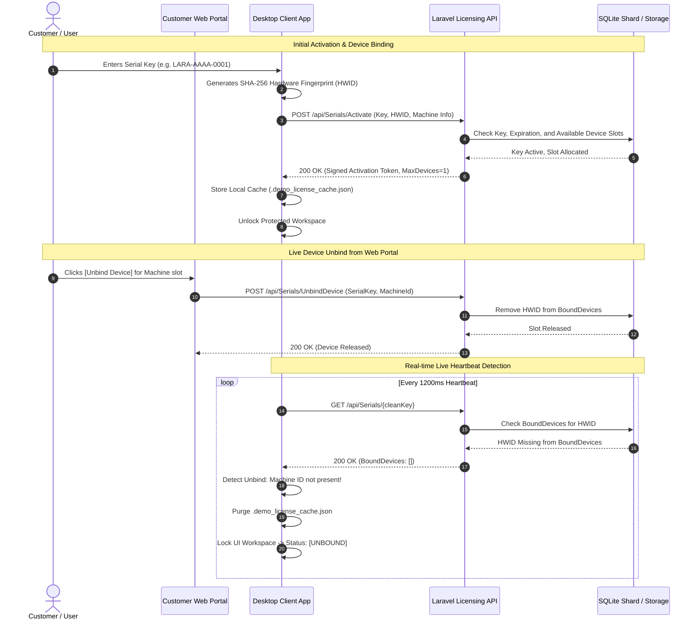

# LaraLicensingV1: Comprehensive System & Architecture Documentation

> **Product Name:** `LaraLicensingV1` (`alimtvnetwork/lara-licensing-v4`)  
> **Repository Version:** `0.691.14`  
> **Platform Classification:** Multi-Tenant Software Licensing, Hardware-Bound Entitlement, Automated Updates, and Partner Management Platform  
> **Primary Technologies:** PHP 8.3 / Laravel 11, React 19 / TanStack Start / Vite, Python 3 / Tkinter, SQLite Split-DB, Tailwind CSS v4, Casbin RBAC, Sanctum  

---

## Table of Contents

1. [Executive Summary & Product Vision](#1-executive-summary--product-vision)
2. [System Architecture & High-Level Diagrams](#2-system-architecture--high-level-diagrams)
3. [Security, Cryptography & Entitlement Protocol](#3-security-cryptography--entitlement-protocol)
4. [Data Architecture & Split-Database Engine](#4-data-architecture--split-database-engine)
5. [Backend Architecture & API Catalog](#5-backend-architecture--api-catalog)
6. [Frontend Portals & Client Surfaces](#6-frontend-portals--client-surfaces)
7. [Desktop Client Simulator & Integration Guide](#7-desktop-client-simulator--integration-guide)
8. [Enterprise Backup & Restore (BR) Engine](#8-enterprise-backup--restore-br-engine)
9. [Application Update & Binary Distribution Subsystem](#9-application-update--binary-distribution-subsystem)
10. [Developer Operations, Testing & Runbooks](#10-developer-operations-testing--runbooks)
11. [Repository Topology & File Mapping](#11-repository-topology--file-mapping)
12. [Coding Standards, Linters & AI Protocols](#12-coding-standards-linters--ai-protocols)

---

## 1. Executive Summary & Product Vision

`LaraLicensingV1` is an enterprise-grade, specification-first platform designed to solve the complete lifecycle of commercial software distribution:
- **Anti-Piracy & Hardware Fingerprinting:** Prevents unauthorized license sharing across machines by cryptographically fingerprinting hardware (CPU architecture, motherboard identifier, MAC address, and hostname).
- **Multi-Tenant Partner & Reseller Distribution:** Empowers software vendors to onboard resellers, allocate license quotas, define custom license prefixes (e.g. `CORP-`, `ACME-`), and enforce independent quota caps.
- **Real-Time Entitlement & Live Device Unbinding:** Provides instant revocation and slot unbinding. When a customer releases a machine slot in the web portal, connected client applications instantly detect the release via live heartbeats and transition to `[UNBOUND]` without manual reboots.
- **Cryptographically Signed Auto-Updates:** Distributes software binary updates alongside Ed25519 cryptographic signatures and channel manifests, enabling client apps to self-update securely.
- **Disaster Recovery & Sharded Data Storage:** Uses a Split SQLite database architecture where platform metadata lives in a central Root DB and each reseller's sensitive customer records live in isolated database shards. Includes an encrypted Backup and Restore (BR) engine featuring Zstandard compression, KEK/DEK envelope encryption, Merkle tree validation, and schema drift detection.

---

## 2. System Architecture & High-Level Diagrams

The system is organized into three primary operational tiers: the **Web Client Surfaces**, the **Backend API & Processing Layer**, and the **Isolated Storage Engine**, with external desktop/embedded software communicating over signed REST channels.



### Complete Request & Entitlement Flow

The sequence below illustrates how an end-user client desktop app verifies its entitlement and detects unbind events live:



---

## 3. Security, Cryptography & Entitlement Protocol

### 3.1 Hardware Fingerprint Generation (HWID)
To eliminate client spoofing and prevent multiple physical machines from sharing a single activation slot, the desktop client and server compute a deterministic SHA-256 hardware digest:

$$\text{HWID} = \text{SHA-256}(\text{Hostname} \mathbin{\Vert} \text{UUID/MAC} \mathbin{\Vert} \text{Architecture} \mathbin{\Vert} \text{OS})$$

Implementation references:
- Client generator: [`scripts/demo_client_app.py:get_machine_fingerprint()`](file:///c:/Users/naimu/Desktop/Licensing/scripts/demo_client_app.py#L78-L94)
- Server binding service: [`backend/app/Services/BindingService.php`](file:///c:/Users/naimu/Desktop/Licensing/backend/app/Services/BindingService.php)

### 3.2 Canonical HMAC-SHA256 Request Signing
Client verification requests communicating over `/api/Portal/*` and `/api/Serials/*` use canonical HMAC-SHA256 authentication:
- **Canonical Payload Structure:**
  ```
  v1\n{HTTP_METHOD}\n{CLEAN_PATH}\n{TIMESTAMP}\n{NONCE}\n{BODY_SHA256_HEX}
  ```
- **Required Headers:**
  - `X-Request-Id`: Unique request trace identifier
  - `X-Lara-KeyId`: Public key identifier
  - `X-Lara-Timestamp`: UNIX epoch seconds (must be within skew window)
  - `X-Lara-Nonce`: Random 16-byte hex nonce
  - `X-Lara-Signature`: `v1={HMAC_SHA256_HEX}`
- Reference: [`backend/app/Http/Middleware/SignedRequestMiddleware.php`](file:///c:/Users/naimu/Desktop/Licensing/backend/app/Http/Middleware/SignedRequestMiddleware.php)

### 3.3 Role-Based Access Control (Casbin RBAC & Sanctum)
The API layer enforces least-privilege role boundaries using Laravel Sanctum for API token authentication paired with Casbin Policy Enforcement Point (`casbin.pep`):
- **SuperAdmin:** Full platform authority across all tenants, prefix registration, backup/restore, audit export, and user management.
- **Admin:** Reseller oversight, quota assignment and approval, prefix inspection, global license revocation, and error management.
- **Reseller:** Restricted strictly to their assigned shard database. Can issue licenses, inspect machine bindings, and submit quota increase requests.
- **Customer / User:** Read-only access to their purchased licenses, device slot unbinding, and renewal requests.
- Reference: [`02-spec/21-app/04-roles.md`](file:///c:/Users/naimu/Desktop/Licensing/02-spec/21-app/04-roles.md) and [`backend/app/Policies/`](file:///c:/Users/naimu/Desktop/Licensing/backend/app/Policies/)

---

## 4. Data Architecture & Split-Database Engine

To ensure strict tenant isolation, scalable multi-tenancy, and rapid backups, `LaraLicensingV1` implements a **Split-Database Architecture** using SQLite.

```
┌─────────────────────────────────────────────────────────────┐
│                       Root Database                         │
│                  (backend/database.sqlite)                  │
│                                                             │
│  - Users & Roles (SuperAdmin, Admin, Resellers)             │
│  - Reseller Directory & Slug Registry                       │
│  - License Prefixes (e.g. LARA-, ACME-, CORP-)              │
│  - Quotas & Quota Requests                                  │
│  - Feature Catalog & Tier-Feature Matrix                    │
│  - Platform Audit Logs & System Error Records               │
│  - App Update Releases & Signed Manifests                   │
│  - Runtime Configurations & Encryption Secrets              │
└──────────────────────────────┬──────────────────────────────┘
                               │
                Dynamically Binds on Request
                               │
       ┌───────────────────────┴───────────────────────┐
       ▼                                               ▼
┌──────────────────────────────┐        ┌──────────────────────────────┐
│       Reseller Shard A       │        │       Reseller Shard B       │
│  (shard_reseller_a.sqlite)   │        │  (shard_reseller_b.sqlite)   │
│                              │        │                              │
│  - Licenses                  │        │  - Licenses                  │
│  - Machine Bindings (HWID)   │        │  - Machine Bindings (HWID)   │
│  - Verification Keys         │        │  - Verification Keys         │
│  - Local Audit Trail         │        │  - Local Audit Trail         │
└──────────────────────────────┘        └──────────────────────────────┘
```

### 4.1 Primary Entities & Database Schema

#### Root Database Models
- [`App\Models\User`](file:///c:/Users/naimu/Desktop/Licensing/backend/app/Models/User.php): Platform accounts with password hashes, roles, and status flags.
- [`App\Models\Reseller`](file:///c:/Users/naimu/Desktop/Licensing/backend/app/Models/Reseller.php): Tenant record defining company name, slug, contact email, and active state.
- [`App\Models\Prefix`](file:///c:/Users/naimu/Desktop/Licensing/backend/app/Models/Prefix.php): Custom prefixes bound to resellers (e.g. `LARA`, `ACME`).
- [`App\Models\Quota`](file:///c:/Users/naimu/Desktop/Licensing/backend/app/Models/Quota.php): Numerical license allocation caps per reseller per tier.
- [`App\Models\QuotaRequest`](file:///c:/Users/naimu/Desktop/Licensing/backend/app/Models/QuotaRequest.php): Formal requests by resellers to increase tier capacity.
- [`App\Models\AppUpdate`](file:///c:/Users/naimu/Desktop/Licensing/backend/app/Models/AppUpdate.php): Release version, channel, binary storage path, and Ed25519 signature.

#### Reseller Shard Models
- [`App\Models\License`](file:///c:/Users/naimu/Desktop/Licensing/backend/app/Models/License.php): Specific issued license containing `LicenseKey`, `Tier`, `MaxMachines`, `ExpirationDate`, `IsActive`, and `IsRevoked`.
- [`App\Models\MachineBinding`](file:///c:/Users/naimu/Desktop/Licensing/backend/app/Models/MachineBinding.php): Active machine bindings recording `MachineFingerprint`, `Hostname`, `IpAddress`, `LastHeartbeatAt`, and `IsActive`.
- [`App\Models\VerifyKey`](file:///c:/Users/naimu/Desktop/Licensing/backend/app/Models/VerifyKey.php): Public/private key pairs used for client offline verification tokens.

### 4.2 Naming & Data Conventions
- **Tables and Entities:** Strictly `PascalCase` (e.g. `Users`, `Resellers`, `MachineBindings`).
- **Columns and Fields:** Strictly `camelCase` in database columns and JSON APIs.
- **Booleans:** Must use positive prefixes: `isActive`, `isRevoked`, `isBound`, `isVerified` (negative forms like `disabled` or `unbound` are forbidden).
- **Primary Keys:** Standard auto-increment integer or deterministic UUIDs.

---

## 5. Backend Architecture & API Catalog

All backend controllers inherit from [`App\Http\Controllers\Controller`](file:///c:/Users/naimu/Desktop/Licensing/backend/app/Http/Controllers/Controller.php) and output responses through [`App\Support\ApiEnvelope`](file:///c:/Users/naimu/Desktop/Licensing/backend/app/Support/ApiEnvelope.php).

### Standard Response Envelopes

**Success Envelope:**
```json
{
  "Ok": true,
  "Data": {
    "SerialKey": "LARA-AAAA-0001",
    "Status": "Active",
    "ExpiresAt": "2027-12-31T23:59:59Z",
    "MaxDevices": 1,
    "BoundDevices": [
      {
        "MachineFingerprint": "9A3F1B0...",
        "Hostname": "DESKTOP-WORK",
        "BoundAt": "2026-10-18T10:00:00Z"
      }
    ]
  }
}
```

**Error Envelope (`AppError`):**
```json
{
  "Ok": false,
  "Error": {
    "Code": "ERR_LICENSE_EXPIRED",
    "Message": "The requested license expired on 2026-06-01.",
    "Details": {
      "SerialKey": "LARA-CCCC-0003",
      "ExpiredAt": "2026-06-01T00:00:00Z"
    },
    "TraceId": "req-trace-9f82a1c"
  }
}
```

### Complete API Endpoint Registry

| Module | HTTP Method | Endpoint Path | Auth & Middleware | Description |
| :--- | :--- | :--- | :--- | :--- |
| **Public** | `GET` | `/api/Public/Health` | None | cPanel / LB public health readiness ping |
| **Auth** | `POST` | `/api/Auth/Register` | `rate.auth:register` | Bootstrap initial SuperAdmin user |
| **Auth** | `POST` | `/api/Auth/Login` | `rate.auth:login` | Authenticate user, return Sanctum token |
| **Auth** | `GET` | `/api/Auth/Captcha` | `rate.auth:captcha` | SVG captcha generator for login forms |
| **Auth** | `POST` | `/api/Auth/ForgotPassword` | `rate.auth:forgot` | Send password reset instructions |
| **Auth** | `POST` | `/api/Auth/ResetPassword` | `rate.auth:reset` | Reset account password |
| **Auth** | `POST` | `/api/Auth/Logout` | `auth:sanctum` | Revoke current user session token |
| **Me** | `GET` | `/api/Me/Capabilities` | `auth:sanctum` | Current user permissions and role profile |
| **Admin** | `GET` | `/api/Admin/Resellers` | `Admin\|SuperAdmin` | List all registered resellers |
| **Admin** | `POST` | `/api/Admin/Resellers` | `Admin\|SuperAdmin` | Create a new reseller tenant |
| **Admin** | `GET` | `/api/Admin/Resellers/{slug}` | `Admin\|SuperAdmin` | Get specific reseller configuration |
| **Admin** | `PATCH` | `/api/Admin/Resellers/{slug}` | `Admin\|SuperAdmin` | Update reseller status or details |
| **Admin** | `GET` | `/api/Admin/Prefixes` | `Admin\|SuperAdmin` | List registered license serial prefixes |
| **Admin** | `POST` | `/api/Admin/Prefixes` | `Admin\|SuperAdmin` | Register a new serial prefix |
| **Admin** | `DELETE`| `/api/Admin/Prefixes/{prefix}` | `Admin\|SuperAdmin` | Deregister a serial prefix |
| **Admin** | `GET` | `/api/Admin/Licenses` | `Admin\|SuperAdmin` | Query licenses across all shards |
| **Admin** | `POST` | `/api/Admin/Licenses` | `Admin\|SuperAdmin` | Issue a license on designated shard |
| **Admin** | `GET` | `/api/Admin/Licenses/{key}` | `Admin\|SuperAdmin` | View license details and hardware bindings |
| **Admin** | `PATCH` | `/api/Admin/Licenses/{key}` | `Admin\|SuperAdmin` | Update license expiration / slot limits |
| **Admin** | `DELETE`| `/api/Admin/Licenses/{key}` | `Admin\|SuperAdmin` | Revoke a license immediately |
| **Admin** | `GET` | `/api/Admin/QuotaRequests` | `Admin\|SuperAdmin` | List pending reseller quota requests |
| **Admin** | `POST` | `/api/Admin/QuotaRequests/{id}/Approve` | `Admin\|SuperAdmin` | Approve and allocate quota increase |
| **Admin** | `POST` | `/api/Admin/QuotaRequests/{id}/Deny` | `Admin\|SuperAdmin` | Reject quota request with reason |
| **Admin** | `GET` | `/api/Admin/Audit` | `Admin\|SuperAdmin` | Query cryptographic audit trail |
| **Admin** | `POST` | `/api/Admin/BR/Export` | `Admin\|SuperAdmin` | Dispatch encrypted full-system backup |
| **Admin** | `POST` | `/api/Admin/BR/Import` | `Admin\|SuperAdmin` | Restore system state with preflight checks |
| **Reseller**| `GET` | `/api/Reseller/{slug}/Licenses` | `Reseller` | List issued licenses within reseller shard |
| **Reseller**| `POST` | `/api/Reseller/{slug}/Licenses` | `Reseller` | Issue a new license deducted from quota |
| **Reseller**| `POST` | `/api/Reseller/{slug}/QuotaRequests` | `Reseller` | Submit a request for quota expansion |
| **Portal** | `GET` | `/api/Serials/{key}` | Signed / Public | Verify serial status and list bound devices |
| **Portal** | `POST` | `/api/Serials/Activate` | Signed / Public | Bind hardware fingerprint to license slot |
| **Portal** | `POST` | `/api/Serials/UnbindDevice` | Signed / Public | Release hardware slot for a machine |
| **App Updates**| `GET` | `/api/App/Updates/Manifest` | Signed / Public | Release manifest for client auto-updates |
| **App Updates**| `GET` | `/api/App/Updates/Assets/{id}` | Signed / Public | Download cryptographically signed binary |

---

## 6. Frontend Portals & Client Surfaces

The frontend is a single-page application built on **React 19**, **TanStack Start**, **Vite**, and **Tailwind CSS v4**, located in [`src/`](file:///c:/Users/naimu/Desktop/Licensing/src/).

### 6.1 Architectural Subsystems
- **Dual Runtime Support (Live Backend vs. Offline Preview):**
  - When the Laravel backend is reachable, requests flow to `/api/*` endpoints.
  - When running standalone without a backend, the frontend activates **Preview Mode** via [`src/lib/preview-store.ts`](file:///c:/Users/naimu/Desktop/Licensing/src/lib/preview-store.ts) and IndexedDB fixtures, allowing complete UI testing with mock data.
- **Role-Gated Routing:**
  - Route tree configured in [`src/routes/`](file:///c:/Users/naimu/Desktop/Licensing/src/routes/) with authenticated wrappers ([`src/routes/_authenticated.tsx`](file:///c:/Users/naimu/Desktop/Licensing/src/routes/_authenticated.tsx)).
  - Unauthorized visitors are automatically redirected to the branded login surface.

### 6.2 Key Portal Surfaces
1. **Admin Console (`/admin`):**
   - Executive metrics (active licenses, pending quota requests, error rates).
   - Reseller management with tenant shard health metrics.
   - Quota approval workflow with real-time capacity projection.
   - Interactive API Documentation viewer powered by OpenAPI / Swagger.
   - Encrypted Backup and Restore dashboard with Merkle verification.
2. **Reseller Workspace (`/reseller/:resellerId`):**
   - Dedicated portal for distributors to generate serials under quota limits.
   - Live hardware binding inspection for reseller customers.
   - Quota increase request form with history and status badges.
3. **Customer License Center (`/portal`):**
   - Self-service dashboard for end-users.
   - Machine slot manager: allows customers to inspect which computers are bound and click `[Unbind Device]` to release machine slots.
   - License key verification and one-click key copying.
   - Renewal and subscription extension requests.

---

## 7. Desktop Client Simulator & Integration Guide

Located in [`scripts/demo_client_app.py`](file:///c:/Users/naimu/Desktop/Licensing/scripts/demo_client_app.py), the Desktop Client Simulator is a standalone Python 3 Tkinter application that emulates commercial client software (e.g., Windows Desktop DAW, CAD, POS terminal, or utility) communicating with the `LaraLicensingV1` server.

```
┌─────────────────────────────────────────────────────────────┐
│          Lara Protected Studio (Desktop Client)             │
├─────────────────────────────────────────────────────────────┤
│ License Key: [ LARA-AAAA-0001                             ] │
│ Machine ID:  [ 9A3F1B008C21EF44 ] (Local Hardware SHA-256)  │
│ Status:      ● ACTIVATED (Expires: 2027-12-31)              │
│ Action:      [ ↻ Sync Live Status ]  [ Deactivate / Unbind ]│
├─────────────────────────────────────────────────────────────┤
│ [WORKSPACE ACTIVE] Studio tools and modules unlocked        │
└─────────────────────────────────────────────────────────────┘
```

### 7.1 Real-Time Live Unbind Detection (1200ms Heartbeat)
A core capability of the licensing platform is live revocation and slot release. When a user releases a machine slot from the web portal:
1. The client background thread executes a non-blocking check every 1200ms (`root.after(1200, ...)`).
2. It queries `/api/Serials/{cleanKey}` and checks if the local machine's HWID is still present in `BoundDevices`.
3. If the server indicates the machine was unbound:
   - Local `.demo_license_cache.json` is purged immediately.
   - Status badge transitions from green `[ACTIVATED]` to amber `[UNBOUND]`.
   - The primary application workspace locks instantly with user restoration guidance.

### 7.2 Running and Testing the Simulator

```powershell
# Launch interactive graphical desktop simulator
python scripts/demo_client_app.py

# Run complete 11-step automated verification suite
python scripts/demo_client_app.py --test-all

# Check or activate a specific serial key from terminal
python scripts/demo_client_app.py --serial LARA-AAAA-0001

# Reset local machine activation cache
python scripts/demo_client_app.py --reset
```

### 7.3 Automated 11-Step Verification Suite
The `--test-all` flag validates 11 real-world scenarios:
1. `Test 1: Hardware Fingerprinting`: Verifies SHA-256 hardware identifier generation.
2. `Test 2: Valid License Activation`: Binds machine to `LARA-AAAA-0001`.
3. `Test 3: Offline Cache Integrity`: Validates local tamper-evident cache file.
4. `Test 4: Expired License Rejection`: Verifies rejection of expired key `LARA-CCCC-0003`.
5. `Test 5: Suspended License Rejection`: Verifies rejection of revoked key `LARA-BBBB-0002`.
6. `Test 6: Machine Limit Enforcement`: Simulates second machine attempting activation on single-seat key.
7. `Test 7: Perpetual License Handling`: Tests key `LARA-EEEE-0005` that never expires.
8. `Test 8: Daily Subscription Expiration`: Validates 24-hour subscription calculation.
9. `Test 9: Invalid Key Format`: Rejects malformed strings (`INVALID-KEY-XYZ`).
10. `Test 10: Server Reachability`: Validates graceful fallback when server is offline.
11. `Test 11: Real-time Device Unbind Detection`: Verifies live slot release from server triggers instant local deactivation.

---

## 8. Enterprise Backup & Restore (BR) Engine

The BR subsystem in [`backend/app/Services/BR/`](file:///c:/Users/naimu/Desktop/Licensing/backend/app/Services/BR/) provides enterprise disaster recovery for multi-tenant SQLite databases.

### 8.1 Cryptographic Architecture
- **Envelope Encryption (KEK / DEK):** Backups are encrypted with AES-256-GCM using a generated Data Encryption Key (DEK). The DEK is encrypted using a Master Key Encryption Key (KEK) managed in [`BrKekService.php`](file:///c:/Users/naimu/Desktop/Licensing/backend/app/Services/BR/BrKekService.php).
- **Zstandard Compression:** High-ratio, high-speed streaming compression via [`BrZstd.php`](file:///c:/Users/naimu/Desktop/Licensing/backend/app/Services/BR/BrZstd.php).
- **Merkle Tree Integrity:** Computes hierarchical SHA-256 Merkle root hashes for all database chunks and manifest files ([`BrMerkleRoot.php`](file:///c:/Users/naimu/Desktop/Licensing/backend/app/Services/BR/BrMerkleRoot.php)), guaranteeing data integrity prior to restoration.

### 8.2 Scope Collectors
Backup exports collect distinct isolated scopes:
- `BrScopeSchemaCollector`: DDL statements and migration versions.
- `BrScopeRbacCollector`: Casbin rules, roles, and user assignments.
- `BrScopeDomainCollector`: Resellers, quotas, prefixes, and configurations.
- `BrScopeLicensesCollector`: Sharded license allocations and machine bindings.
- `BrScopeSecretsCollector`: Encrypted verification keys and secrets.
- `BrScopeFilesCollector`: Update binary files and release assets.

---

## 9. Application Update & Binary Distribution Subsystem

The platform functions as a secure software release repository:
- **Signed Manifests:** Client applications request `/api/App/Updates/Manifest?Channel=stable&CurrentVersion=1.0.0`. The response includes the download URL, target version, changelog, and cryptographic signature.
- **Ed25519 Binary Signatures:** All executable assets (`.exe`, `.msi`, `.dmg`, `.zip`) are signed before storage using an Ed25519 private key. Client apps verify the signature using the embedded public key before running installers, preventing Man-In-The-Middle (MITM) tampering.
- **Channel Segregation:** Supports `stable`, `beta`, and `nightly` release channels.

---

## 10. Developer Operations, Testing & Runbooks

### 10.1 Starting the Complete Development Stack
To start the entire platform locally, open three terminals or run background services:

```powershell
# Terminal 1: Start Laravel Backend Server (Port 8000)
cd backend
php artisan serve --port=8000

# Terminal 2: Start Vite React Frontend (Port 8080)
# (In root directory)
.\node_modules\.bin\vite.cmd dev

# Terminal 3: Start Protected Desktop App Simulator
python scripts/demo_client_app.py
```

Access Points:
- Web Portal / UI: `http://localhost:8080`
- Backend API: `http://127.0.0.1:8000/api`
- API Health Probe: `http://127.0.0.1:8000/api/Public/Health`

### 10.2 Quality Assurance & Testing Suite

```powershell
# 1. Run Backend Pest Test Suite
cd backend
php artisan test

# 2. Run Playwright End-to-End Tests
bun run test:e2e:smoke

# 3. Run Python Client Verification Suite
python scripts/demo_client_app.py --test-all

# 4. Run Frontend Linters & Type Checking
bun run typecheck
bun run lint:strict
bun run lint:api-surface
```

---

## 11. Repository Topology & File Mapping

```
c:\Users\naimu\Desktop\Licensing\
├── README.md                      # Human and AI orientation entry point
├── package.json                   # Frontend dependencies, scripts, and build tasks
├── vite.config.ts                 # Vite bundler, proxy rules, and Tailwind configuration
├── run.ps1 / run.sh               # Root release and packaging orchestrator
│
├── backend/                       # Laravel 11 Backend Platform
│   ├── app/
│   │   ├── Http/Controllers/      # API Controllers (Admin, Reseller, Portal, Auth, BR)
│   │   ├── Http/Middleware/       # HMAC signing, Casbin PEP, Rate limiters
│   │   ├── Models/                # Eloquent models (User, Reseller, License, Quota, etc.)
│   │   ├── Policies/              # Authorization policies
│   │   ├── Services/              # Core business services & BR subsystem
│   │   └── Support/               # ApiEnvelope, AuditWriter, QueryResult helpers
│   ├── database/                  # Migrations, seeders, and Split-DB SQLite files
│   ├── routes/api.php             # Authoritative REST API route definitions
│   └── tests/                     # Pest & PHPUnit backend test suites
│
├── src/                           # Frontend React 19 Application
│   ├── components/                # Reusable UI primitives (Radix UI, Tailwind v4)
│   │   ├── admin/                 # Admin console panels, tables, and dialogs
│   │   ├── reseller/              # Reseller license management components
│   │   └── portal/                # Customer request history and unbind controls
│   ├── lib/                       # API clients, auth stores, and preview fixtures
│   └── routes/                    # File-based routing (Admin, Reseller, Portal, Auth)
│
├── scripts/                       # Maintenance and Client Simulation Tools
│   ├── demo_client_app.py         # Desktop Client Simulator & 11-step test runner
│   ├── publish-backend.ps1        # Packaging script for backend deployment
│   └── publish-frontend.ps1       # Packaging script for frontend distribution
│
├── 02-spec/                       # Formal Architecture & Engineering Specifications
│   ├── 01-spec-authoring-guide/   # Standard specifications authoring guidelines
│   ├── 02-coding-guidelines/      # Multi-language naming and code quality rules
│   ├── 03-error-manage/           # Universal AppError taxonomy and contracts
│   ├── 04-database-conventions/   # Split SQLite and PascalCase schema conventions
│   └── 21-app/                    # App domain specs (RBAC, API contracts, HWID binding)
│
└── .ai-memory/                    # Persistent Project Memory & Knowledge Base
    ├── what-to-read.md            # Canonical ordered reading list for AI sessions
    ├── overview.md                # High-level architecture onboarding frame
    └── strictly-avoid.md          # Non-negotiable architectural prohibitions
```

---

## 12. Coding Standards, Linters & AI Protocols

All future modifications to this codebase must adhere to the following non-negotiable rules:
1. **Never Rewrite Git History:** This repository is connected to Lovable. Never execute force pushes (`git push --force`) or amend/rebase published commits.
2. **Naming Conventions:**
   - Database tables, types, and model entities: `PascalCase`.
   - Database columns and JSON API fields: `camelCase`.
   - File and folder slugs: `kebab-case` with numeric prefixes where ordering matters.
   - Booleans: strictly positive names starting with `is` or `has` (never negative names like `disabled`, `unbound`, or `notActive`).
3. **Function & File Length Caps:**
   - Functions: optimal 8 lines, hard cap 15 lines (waiver up to 25 lines requires `# lint-allow: function-length`).
   - Source files: 80 to 100 lines target.
4. **Clean Error Handling:**
   - Never swallow exceptions or introduce empty `catch` blocks.
   - Use structured `AppError` envelopes with distinct error codes, user-safe messages, and trace IDs.
5. **No Em Dashes or En Dashes:** Use colons, commas, hyphens, or parentheses instead.
6. **Clickable Links:** Always provide file links in GitHub-style markdown using the `file:///` URI scheme.
